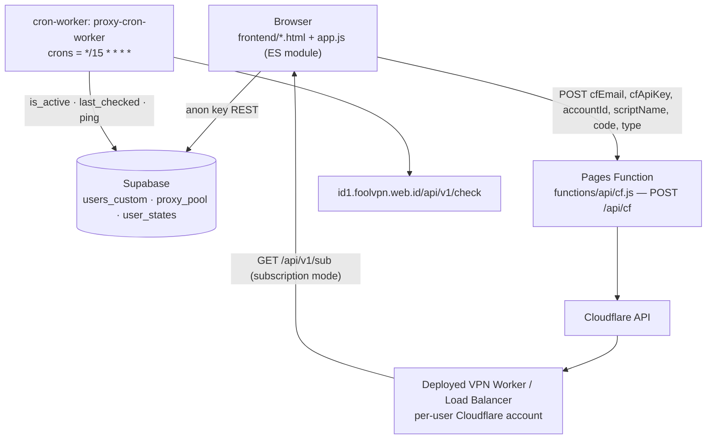

# Repository Guidelines

## Project Overview

`cfvpn-hub` (npm name `jhopan-sub-pages`) is a management panel for Cloudflare VPN (VLESS-over-WebSocket) Workers: deploy/monitor Workers and a Load Balancer, generate client configs (Raw / V2Ray base64 / Clash YAML / Sing-box), and curate the proxy pool the Workers route through.

- Live: https://cfvpn-hub-9xy.pages.dev (Pages project `cfvpn-hub` di akun Adelia — target deploy saat ini)
- Live lama: https://cfvpn-hub-dcx.pages.dev (akun Alan; tidak dipakai lagi)
- Repo: https://github.com/jhopan/cfvpn-hub — branch `main`; push to `main` → Cloudflare Pages rebuild (build output dir = `frontend`).
- No build step, no framework, no bundler. `frontend/` is uploaded verbatim.

Three independently deployed units:

| Unit | Config | Deploy |
|---|---|---|
| Pages project `cfvpn-hub` (frontend + `functions/api/cf.js`) | `wrangler.toml` | `npm run deploy` (akun Adelia — lihat “Deployment identity”) / GitHub auto-deploy |
| Cron Worker `proxy-cron-worker` | `cron-worker/wrangler.toml` | manual `cd cron-worker && npx wrangler deploy` |
| Per-user VPN Workers / Load Balancer | `frontend/source/*.js` templates | panel Deploy page, or `deploy-bulk.mjs` |

## Architecture & Data Flow

Browser-only auth and state: the SPA talks to Supabase REST directly with the **anon key hardcoded in `frontend/app.js:4`**, and to Cloudflare only through the Pages Function.



- **Auth (client-side only).** Session lives in `localStorage["CFVPN-vpn-panel-session"]`. Protected pages carry an inline head guard `if(!localStorage.getItem("CFVPN-vpn-panel-session"))location.replace("landing.html")`; `checkAuth()` (`app.js:147`) re-enforces it, bounces authed users off `login.html`/`register.html` to `index.html`, and redirects non-admins off `admin.html`. Passwords are SHA-256 hex (`hashPassword`, `app.js:752`) compared against `users_custom.password_hash` over the anon REST key (`app.js:825`). There is no Supabase Auth and no server-side authorization anywhere.
- **State.** `state` + `currentUser` are module globals in `app.js`; persistence is `user_states.state_data` (`emptyState` = `{generatedCount: 0, workers: []}`, worker = `{id, name, host, type: "vpn"|"load_balancer", active, source, vpn_domains?}`), upserted `onConflict: "username"` (`app.js:187`). `localStorage` only holds the session plus 6-hour caches (`proxyActiveCountCache`, `proxyPickerCache`, `proxyListCache`).
- **Deploy path.** `deploy.html` collects the user's Cloudflare credentials → `app.js` fetches `/source/vpn-worker-free.js` \| `vpn-worker-prem.js` \| `load-balancer.js` (tier/type gated, `app.js:672-692`) → `POST /api/cf` → `functions/api/cf.js`: `stripComments(code)`, GET account subdomain, multipart PUT the script (`metadata.main_module`, `compatibility_date: "2024-05-12"`), POST enable subdomain → `{success, host, subdomain}` → `app.js:710` appends the worker to `state.workers` with `source:"cloudflare-auto"`.
- **Generator.** Local mode filters `proxy_pool` (`is_active` + `last_checked` newer than 6 h) and emits one VLESS URI per proxy×port, capped by `limit`; subscription mode calls the LB Worker's `/api/v1/sub` with `cc`, `port`, `limit`, `format`, `tier`, `domains` and falls back to showing the manual URL on failure.
- **Proxy freshness.** `cron-worker` (`*/15`) memverifikasi proxy **sendiri** (`src/proxy-check.mjs`: SOCKS5 → fallback HTTP CONNECT → `GET cp.cloudflare.com/generate_204`, hanya 2xx/3xx yang dihitung hidup) lalu menulis `ping`/`last_checked` untuk baris yang lolos, dan **hanya** `is_active=false` untuk baris yang gagal — worker ini tidak pernah menyalakan baris, karena cek dangkal 5 s bisa lolos di proxy non-TLS dan verifikasi mendalam (`proxy-scraping` di mesin pengguna) yang berhak menaikkannya; batch kecil (hanya baris yang sudah aktif, dari yang paling lama tidak dicek) karena tiap pemeriksaan butuh handshake nyata. API pemeriksa lama (`id1.foolvpn.web.id`) sudah mati dan tidak dipakai lagi. `proxy-scraper/` mengisi tabel yang sama secara massal lewat logika pemeriksa yang sama.
- **Worker templates.** `frontend/source/vpn-worker-free.js` and `vpn-worker-prem.js` are byte-identical (prem tier is a panel-side gate only): the proxy target arrives in the WebSocket path `/<ip>-<port>` (IPv6 juga terbaca — port diambil dari kanan), TCP runs through the proxy, DNS (`cmd=2`, port 53) is answered by the Worker itself via DoH, and any other UDP port is closed immediately because Workers have no outbound UDP. Detail yang penting untuk performa & kompatibilitas:
  - **Endpoint DoH berantai**: `env.DOH_ENDPOINT` → `env.DOH_FALLBACK` (kalau salah satu diset, HANYA itu yang dipakai) → bawaan `1.1.1.1/dns-query` lalu `dns.google/dns-query`. Kalau semua gagal, klien menerima **SERVFAIL** (bukan diam sampai timeout).
  - **Cache DoH per-isolate** (`dnsCache`): kunci = nama+tipe+kelas (tanpa txid, huruf kecil), TTL dari catatan pertama dijepit 30..600 detik, maksimal 256 entri; txid balasan ditulis ulang sesuai pertanyaan. Ini memotong subrequest `fetch` untuk domain yang diulang dalam satu penjelajahan.
  - **Query identik yang sedang jalan berbagi satu panggilan DoH** (`dnsInflight`): beberapa koneksi ke domain yang sama sering dibuka bersamaan; tiap pemanggil tetap menerima balasan dengan txid-nya sendiri.
  - **Protokol proxy diingat per `host:port`** (`proxyProtocols`, maks 64 entri): proxy HTTP-only tidak lagi membayar satu koneksi + satu round trip SOCKS5 di setiap koneksi berikutnya. Probing greeting SOCKS5 dibatasi `SOCKS5_PROBE_TIMEOUT` (2,5 s) supaya proxy yang diam saja tidak menahan 8 detik; sisa tahap handshake tetap 8 detik.
  - **Writer ke soket proxy ditahan selama tunnel hidup** (`writeToRemote`) — tidak ada lagi `getWriter()`/`releaseLock()` untuk setiap potongan data dari klien; setelah target menutup, state dilepas supaya potongan berikutnya tidak menulis ke soket mati.
  - **Failover proxy (bukan rotasi)**: kalau proxy di path gagal, worker mencoba cadangan dari `env.FALLBACK_PROXIES` lalu (kecuali `env.FALLBACK_POOL=off`) 16 baris teratas `proxy_pool` dari Supabase — daftar itu di-cache 120 detik per isolate dan dihangatkan di latar belakang saat koneksi mulai. Maksimal `FALLBACK_MAX` (3) percobaan; proxy utama tetap dipakai selama sehat, jadi IP keluar bisa berbeda dari yang tertulis di URI klien saat failover aktif. **Hedge, bukan pemendekan timeout:** proxy utama dicoba dengan timeout normal, tetapi kalau belum selesai setelah `HEDGE_DELAY_MS` (1,5 s) jalur cadangan mulai berjalan paralel dan tunnel pertama yang selesai "mengklaim" koneksi (yang kalah menutup soketnya sendiri). Ini penting: memendekkan timeout proxy utama pernah dicoba dan justru *meregresi* proxy lambat-tapi-sehat (terukur di edge: probe 6 proxy turun dari 5/6 ke 4/6); dengan hedge, alamat yang pasti mati (`192.0.2.1:1080`) dilayani cadangan dalam 3,9 s sedangkan sebelum ada failover gagal di 8,7 s. Anon key Supabase hardcoded di template, sama seperti `load-balancer.js`; endpoint pool bisa dialihkan lewat `FALLBACK_POOL_URL`.
  - **Watchdog idle/half-open** (`IDLE_CLOSE_SECONDS`, bawaan 180, `0` = mati): kalau klien sudah mengirim data tetapi tidak ada data dari target selama N detik, koneksi ditutup dengan kode 1001 "target tidak menjawab" — proxy "setengah mati" tidak lagi menggantung sampai CDN yang memutus.
  - **Cache DNS berlapis** (`DNS_CACHE_MODE`: `both` bawaan, `memory`, `cache`, `off`): Map per-isolate dulu, lalu Cache API (kunci `/__dnscache__/<nama+tipe+kelas>` di host worker sendiri; hasil dari Cache API dipromosikan ke memori). Jawaban negatif (NXDOMAIN/NODATA) di-cache 30 detik; SERVFAIL dan jawaban terpotong tidak di-cache. Hitungan hit/miss per lapisan muncul di `/health`.
  - **Query DNS dalam satu frame dikerjakan paralel** dan balasan dikirim begitu siap (urutan datagram tidak dijamin — sama seperti UDP asli; klien mencocokkan lewat txid, dan `tests/smoke-vpn-worker.mjs` menguji secara order-agnostic).
  - **Alamat tujuan numerik dikirim sebagai ATYP 1 (IPv4) / 4 (IPv6)** di permintaan SOCKS5, bukan sebagai domain, supaya proxy tidak perlu resolusi sendiri; pada HTTP CONNECT, IPv6 ditulis `[addr]:port` (request line + `Host`).
  - **Header balasan VLESS (2 byte) dikirim begitu tunnel siap**, tidak menunggu byte pertama dari target.
  - Early data lewat `sec-websocket-protocol` tetap didukung; `Upgrade` dibandingkan tanpa peduli besar-kecil huruf.
  Configuration enters only via Cloudflare `env` (`REVERSE_PRX_TARGET`, optional `UUID_ALLOWLIST`, `DOH_ENDPOINT`/`DOH_FALLBACK`). `load-balancer.js` embeds the Supabase REST URL + anon key (`load-balancer.js:5-6`), so the anon key ships inside every deployed LB Worker.

## Key Directories

| Path | Purpose |
|---|---|
| `frontend/` | Cloudflare Pages output; served verbatim |
| `frontend/app.js` | The whole SPA (ES module, ~1130 lines) — auth, nav, dashboard, workers, generator, deploy, proxy pool, admin |
| `frontend/*.html` | 9 pages: `index` (dashboard), `landing` (public), `login` (login+register tabs), `register` (redirect stub to `login.html#register`), `workers`, `generator`, `proxy`, `deploy`, `admin` |
| `frontend/source/` | VPN Worker + Load Balancer templates uploaded by the deploy flow |
| `frontend/sw.js`, `frontend/manifest.json` | PWA service worker and manifest |
| `functions/api/cf.js` | Pages Function → `/api/cf`, proxies Cloudflare API with creds from the request body |
|`cron-worker/`|Separate Worker: proxy health checker (`src/index.js`), own `package.json`/lockfile. **Hanya mengawasi `is_active=true` dan boleh mematikannya saja — tidak pernah menyalakan** (cek dangkal 5 s bisa lolos di proxy non-TLS, dan verifikasi mendalam `proxy-scraping` yang berhak menaikkan baris)|
| `proxy-scraper/` | Local CLI: 55 sumber (52 aktif) → ~160k kandidat unik → dedupe → filter port terbuka → verifikasi handshake nyata → tulis ke `proxy_pool` (`sources.mjs`, `sources-check.mjs`, `node-socket.mjs`, `index.mjs`) |
| `deploy-bulk.mjs` | Local interactive batch deploy/status/delete menu for Worker templates |
| `tests/` | Node `node:test` files — see Testing & QA (currently stale) |

## Development Commands

```bash
npm install                                   # root deps (wrangler + @supabase/supabase-js + playwright)
npm run dev                                   # wrangler pages dev frontend --compatibility-date=2024-05-12
npm run deploy                                # wrangler pages deploy frontend (akun Adelia; flag --compatibility-date TIDAK didukung untuk `pages deploy` di wrangler 4.118)
nrun node --check frontend/app.js             # mandatory syntax gate after editing app.js
nrun node deploy-bulk.mjs                     # operator batch menu (reads workers.txt, writes deployed.txt/status.txt)
cd cron-worker && npm install && npx wrangler deploy   # cron worker (deploy manually)
nrun node proxy-scraper/index.mjs             # scrape multi-sumber + verifikasi 2 tahap, tulis yang hidup ke proxy_pool
nrun node --test tests/                       # test runner (see caveats below)
```

Local dev serves `http://localhost:8788` (wrangler Pages default).

## Deployment Identity

Deploy target sekarang **akun Adelia**, bukan akun Alan.

| Item | Nilai |
|---|---|
| Identitas wrangler | OAuth `adelia140845@gmail.com`, account `f8ab047719232d46d2185cbc6655dee3` — token di `C:\Users\ACER\.wrangler\config\default.toml` |
| Pages project | `cfvpn-hub` → https://cfvpn-hub-9xy.pages.dev (semua halaman 200 di path extensionless; `*.html` 308 → extensionless, sama seperti situs lama) |
| Akun lama | Alan `alantampan1203@gmail.com` / `cd15e050fa56faa61e6b796b3c4e41e5` — kredensialnya sudah dikomentari di `.env`, jangan diaktifkan lagi |

Kredensial wrangler dibaca berlapis: env var `CLOUDFLARE_API_KEY`+`CLOUDFLARE_EMAIL` > `--env-file` > `.env` di cwd > OAuth. Karena itu `.env` **tidak boleh** lagi memuat `CLOUDFLARE_*` (barisnya dikomentari); Supabase URL/anon key di sana tetap dipakai sebagai dokumentasi.

Gotcha: `wrangler pages` menyimpan `account_id` + `project_name` di `.wrangler/cache/pages.json`. Kalau akun berganti, hapus file itu dulu — kalau tidak, perintah Pages menembak akun lama dan gagal `Authentication error [code: 10000]`.

```bash
npx wrangler whoami                 # pastikan adelia140845@gmail.com
rm .wrangler/cache/pages.json       # hanya kalau akun barusan diganti
npx wrangler pages project list
npm run deploy
npx wrangler logout / npx wrangler login    # ganti identitas OAuth
```

Supabase CLI: `supabase@3.1.0`. Login aktif = akun **adelia140845@gmail.com** (token di Windows keyring; `~/.supabase` tidak menyimpan file token). Project panel sekarang **`lumbbmhhmkcnxunuryjr`** (org `Adelia Hub`, region `ap-southeast-1`), dibuat 2026-11-12 lewat `supabase projects create`; skemanya ada di `supabase/schema.sql`. Perintah yang terbukti jalan di mesin ini:

```bash
npx supabase@latest whoami
npx supabase@latest orgs list --output-format json
npx supabase@latest projects list --output-format json
npx supabase@latest projects api-keys --remote=<ref> --reveal --yes
npx supabase@latest db query --remote=<ref> -f supabase/schema.sql --yes    # jalankan SQL tanpa psql
```

Project lama `cgflrpjavyotvolnvcnl` (anon-key-only, bukan milik akun ini) tidak lagi dipakai; kuncinya tidak bisa dipakai untuk DDL karena tidak ada service key/token di akun itu.

## Code Conventions & Common Patterns

- **No bundler.** `app.js` is an ES module with exactly one import — `https://cdn.jsdelivr.net/npm/@supabase/supabase-js/+esm` (`app.js:1`) — and no exports. Never add a bare-module import; use full CDN URLs or relative paths. All 8 non-stub pages load it as `<script type="module" src="app.js">`.
- **Encoding trap.** `app.js` must be UTF-8 **without BOM**; a BOM produces `SyntaxError: Unexpected token '}'`. Same for other shipped JS.
- **Naming.** JS/identifiers camelCase; DOM ids camelCase and feature-first (`deployTier`, `proxyTableBody`, `addAdminForm`, `subLimitInput`). Supabase columns stay snake_case (`password_hash`, `is_active`, `last_checked`, `state_data`) — never rename one side to “fix” the mismatch.
- **DOM/dependency pattern.** No framework: each page declares its own markup, and `app.js` renders by `innerHTML` template strings + `escapeHtml` (`app.js:205`) for user data. Use data attributes for delegated events (`data-toggle-role`, `data-delete-user`, `dataset.editId`). `renderNav()` is the single place that reveals admin UI.
- **Role gating = hide, don't merely disable.** `renderNav` (`app.js:225-266`) unhides `.admin-toolbar` / admin nav and the premium tier option only for `currentUser?.role === "admin"`; non-admins must be forced to `vpn-worker-free.js`.
- **Fungsi handler shape.** `onRequest(context)` only; reject non-POST with 405 JSON; validate required fields → 400 `{error}`; success → `{success: true, ...}`; unexpected → 500 `{error: error.message}`; Cloudflare auth via `X-Auth-Email`/`X-Auth-Key`.
- **Worker upload TANPA komentar (penting).** `frontend/source/*.js` dikirim ke API Cloudflare lewat `functions/api/cf.js` / `deploy-bulk.mjs`, dan keduanya **wajib** melewatkan kode ke `stripComments()` (`functions/api/strip-comments.js`) sebelum upload. Bukti terukur (12 Nov): source apa adanya (23.094 byte, 28 baris komentar) → Worker hidup 1 request lalu `500 / error 1101` selamanya; source yang sama setelah komentar dibuang (21.271 byte) → `200` ×12 selama 96 detik + tunnel VLESS 3/3 PASS. `wrangler deploy` tidak pernah kena karena esbuild membundel tanpa komentar. Jangan kirim `code` mentah ke endpoint upload.
- **Error handling.** `async/await` everywhere; wrap Supabase/fetch in `try/catch`; surface user-facing text through `setMessage(id, message, error)` (`app.js:208`); `console.*` for diagnostics. Silent `.catch(() => {})` only for non-critical paths (SW install, subdomain enable, cache prefetch).
- **Timeouts.** Network guards use explicit limits — `AbortSignal.timeout(15000)` for LB subscription fetches, 5 s for per-proxy health checks.
- **Comments/UI copy are Indonesian** (`// Diganti checkAuth()`, `Tidak ada …`); comments in `cf.js` from earlier drafts are stale — trust behaviour over comments.
- **Cache busting.** Bump `CACHE_NAME` in `frontend/sw.js` (`cfvpn-hub-v2`) whenever a cached asset changes, or users keep the old copy.
- **Compatibility date lives in two places** and must stay in sync: `wrangler.toml` and the upload metadata in `functions/api/cf.js`. `wrangler pages deploy` rejects `--compatibility-date` in wrangler 4.118 (`wrangler pages dev` still accepts it), so the npm `deploy` script must not pass that flag.

## Important Files

| File | Why it matters |
|---|---|
| `frontend/app.js` | Single source of client behaviour; every feature lives here |
| `frontend/index.html` … `admin.html` | Head guard, nav, form ids that `app.js` queries by id |
| `functions/api/cf.js` | Only server route; validates `{cfEmail, cfApiKey, accountId, scriptName, code, type}` and uploads the Worker |
| `frontend/source/vpn-worker-free.js` / `vpn-worker-prem.js` | Byte-identical VLESS-over-WS templates: TCP via proxy (SOCKS5 ATYP 1/4 untuk IP numerik → fallback HTTP CONNECT), DNS via DoH berantai + cache per-isolate (SERVFAIL kalau semua endpoint gagal), UDP lain ditutup cepat |
| `frontend/source/load-balancer.js` | Subscription API `/api/v1/sub`; embeds Supabase URL + anon key |
| `cron-worker/src/index.js` + `cron-worker/wrangler.toml` | Proxy health loop, `*/15 * * * *`, `/trigger` fetch hook |
| `deploy-bulk.mjs` | Operator TUI: deploy/status/delete Workers; needs `CF_EMAIL`/`CF_API_KEY`/`CF_ACCOUNT_ID` |
| `wrangler.toml`, `package.json` | Pages config, output dir, npm scripts |
| `README.md` | Indonesian end-user docs incl. the Supabase SQL schema (only place it exists — there are no `.sql` files or migrations) |

## Runtime/Tooling Preferences

- **Runtime:** Node (npm, `package-lock.json` in root, `cron-worker/`, `proxy-scraper/`). No Bun anywhere. `wrangler` is pinned to `latest`, so CLI behaviour can drift.
- **Shell:** Hermes terminal is **WSL2 bash**, not Git Bash → Windows paths are `/mnt/c/Users/ACER/...` (never `/c/...`). `node` is absent from the WSL PATH: use the wrapper `nrun node <file>` (`/mnt/c/Users/ACER/bin/nrun`).
- **Path literals in JS/`.mjs` files are native Windows** (`C:/Users/ACER/...`).
- **Deploy rule:** never `wrangler deploy` the frontend — that ships a Worker. Use `npm run deploy` (Pages) or the cron Worker's own directory.
- **Secrets.** `.env` is gitignored and *no repo code reads it* (no dotenv), **but wrangler itself loads it** from the working directory — the `CLOUDFLARE_*` lines are deliberately commented out there so wrangler falls back to the Adelia OAuth login instead of a global API key. `deploy-bulk.mjs` still expects `CF_EMAIL`/`CF_API_KEY`/`CF_ACCOUNT_ID` (never present). Supabase URL/anon key are hardcoded in `frontend/app.js:3-4`, `cron-worker/src/index.js:16-17`, `proxy-scraper/index.js:4-5`, `frontend/source/load-balancer.js:5-6`.
- **Cloudflare API keys must never enter the frontend or `frontend/source/`**; the panel deliberately accepts a user-supplied key per deploy request and forwards it through `/api/cf`.
- Repo hygiene: `.test-candidates.sh`, `.xray-working.json`, `.xray-candidates.json`, `.vless-url.txt` are untracked **but not gitignored** (they carry live VLESS UUIDs/hosts), and `test-xray-vless.json` is tracked while carrying a UUID. Don't add more such files; suggest `.gitignore` entries instead of committing them.

## Testing & QA

- **Framework:** Node's built-in `node:test` + `node:assert/strict`; 5 files under `tests/` (4 stale ones below + `smoke-vpn-worker.mjs`, which is current). No test script in `package.json`, no CI, no ESLint/Prettier/EditorConfig, no Playwright config (though `playwright` is a devDependency — unused).
- **Current state — suite is stale, do not trust it as a gate:**
  - `tests/auth.test.mjs`, `tests/dashboard.test.mjs`, `tests/pages.test.mjs` read `../public/`, a directory that no longer exists (output dir is `frontend/`) → they fail before asserting anything.
  - `tests/sub.test.mjs` imports `../functions/api/sub.js`; only `functions/api/cf.js` exists.
  - Assertions also pin removed behaviour (`dummyCredits`, `requireAuth`, `id="credits"`), so re-pinning them by editing test text is wrong — fix the fixture paths/imports and rewrite assertions against current behaviour, or delete what no longer has a subject.
- **Static checks that do apply:** `nrun node --check frontend/app.js` (syntax gate) and `nrun node --check` on any file you touch; `functions/api/cf.js` has no automated coverage.
- **Worker smoke test (jalur WS/VLESS + DNS/DoH):** `nrun node tests/smoke-vpn-worker.mjs` — menjalankan `frontend/source/vpn-worker-prem.js` lewat `wrangler dev` lokal dengan `[vars] DOH_ENDPOINT` diarahkan ke stub DoH `127.0.0.1:7303` (isinya byte-identik dengan file di repo), lalu memeriksa **23 skenario**: framing UDP `[2B panjang][query]` dan varian polos, header respons VLESS 2 byte, header yang terpecah antar frame, dua datagram dalam satu frame (urutan balasan bebas), penutupan cepat untuk UDP non-53, jalur TCP lewat proxy, penutupan socket, ATYP numerik SOCKS5 (`05010001...` untuk IPv4, `05010004...` untuk IPv6), kurung siku pada `CONNECT [ipv6]:443`, cache DoH (query sama diulang tidak memanggil DoH lagi tapi txid tetap diperbarui), protokol proxy diingat (`proxyProtocolOrder`: koneksi kedua ke proxy HTTP-only tidak mencoba SOCKS5), query DNS identik bersamaan (satu panggilan DoH, dua balasan ber-txid sendiri), UUID di luar `UUID_ALLOWLIST` ditolak, **failover** (proxy utama mati di port 7307 → cadangan dari `FALLBACK_PROXIES` dipakai) dan kebalikannya (proxy sehat → cadangan tidak dipakai), **failover dari pool** (worker dengan `FALLBACK_POOL_URL` menunjuk REST palsu di 7309: daftar ditunggu lalu dipakai), **cache DNS negatif** (NXDOMAIN tidak di-query ulang), `/health` melaporkan hitungan isolate, **Cache API** (worker dengan `DNS_CACHE_MODE=cache`: query kedua dilayani cache bersama tanpa DoH), fallback DoH (endpoint utama sengaja mati → `DOH_FALLBACK`), SERVFAIL saat semua endpoint DoH mati, **watchdog** (worker dengan `IDLE_CLOSE_SECONDS=1`: proxy di port 7308 handshake sukses tapi diam → koneksi ditutup dalam ~1 detik), dan bahwa free dan prem identik. Stub: 7301 dial-langsung, 7302 & 7306 proxy penolak-SOCKS5 (yang kedua untuk menguji memo protokol), 7303 DoH (nama berawalan `nx` dijawab NXDOMAIN), 7304 proxy SOCKS5 penerima no-auth, 7308 proxy "setengah mati", 7309 REST `proxy_pool` palsu. Empat worker dijalankan: utama (`SMOKE_PORT`), uji DoH (port+1), watchdog (port+2), uji pool (port+3). Port worker bisa diganti lewat `SMOKE_PORT` — pakai ini kalau 8787 sudah dipakai proses lain. Butuh Node ≥ 22 (global `WebSocket`) dan `wrangler` lokal; keluar dengan kode 1 kalau ada yang gagal.
- **Production VLESS test (jalur nyata ke worker ter-deploy):** `python tests/prod-vless-dns.py [host] [path]` — klien VLESS-over-WebSocket murni stdlib (tanpa Node), menguji `00 00` + `[2B panjang][jawaban DNS]` untuk framing Xray maupun polos, header yang terpecah antar pesan WS, dua datagram dalam satu pesan, penutupan cepat UDP non-53, dan `GET /health`. Butuh worker yang sudah ter-deploy (mis. `vpn-worker-prem.adelia140845.workers.dev`) dan cloudflared/Cloudflare tidak memblokir UA klien — skrip sudah memakai UA browser.
- **Production proxy probe (klien mana yang benar-benar tembus):** `python tests/prod-proxy-check.py <worker-host> ip:port [...]` — untuk tiap kandidat membuka WS ke `/<ip>-<port>` (format panel), mengirim frame VLESS `cmd=1` ke `example.com:80`, lalu memastikan muncul `HTTP/1.`. Dipakai karena kolom `is_active` di `proxy_pool` tidak lagi terpercaya saat cron checker mati. Klien WS bersama ada di `tests/vless_ws.py`. **Penting:** kalau failover pool worker aktif (bawaan), proxy yang mati bisa tampak HIDUP karena worker pindah ke cadangan — untuk mengukur proxy apa adanya, deploy worker uji dengan `FALLBACK_POOL = "off"`. Sebaliknya, sabuk pengaman failover diuji dengan memberi satu alamat yang pasti mati (mis. `192.0.2.1:1080`, TEST-NET-1): request harus tetap berhasil lewat cadangan.
- **Checker cron worker (logika uji proxy):** `nrun node tests/check-proxy.mjs [ip:port ...]` — menjalankan `checkProxy` dari `cron-worker/src/proxy-check.mjs` di Node dengan soket Node sebagai pengganti `connect` dari `cloudflare:sockets`. Tanpa argumen memakai 3 proxy hidup + 2 alamat mati sebagai kontrol; exit 1 kalau hasilnya di luar dugaan.
- **Uji sumber daftar proxy:** `nrun node proxy-scraper/sources-check.mjs [--out file.txt] [--timeout ms]` — mengambil semua sumber di `sources.mjs` paralel, lalu melaporkan status HTTP, ukuran, jumlah proxy yang terbaca, dan verdict per sumber (`OK` / `KOSONG` / `GAGAL`); sumber bertanda `optional: true` hanya jadi peringatan. Tanpa argumen lain ia juga bisa menuliskan gabungan kandidat unik ke `--out`. Exit 1 kalau ada sumber wajib yang KOSONG/GAGAL. Katalog saat ini: 55 entri (52 OK, 3 opsional 502) → ±160.000 proxy unik.
- **Scraper proxy (jalur utama mengisi pool):** `nrun node proxy-scraper/index.mjs [--cap N] [--offset N] [--tcp-jobs N] [--check-jobs N] [--check-limit N] [--flush N] [--socks-timeout ms] [--http-timeout ms] [--probe-timeout ms] [--only-file file] [--dump file] [--dry-run] [--verbose]` — sumber mentah dari `sources.mjs`, parser generik `ip:port` (teks, JSON yang memisah `ip`/`port`, JSON ter-escape, tabel HTML), dedupe, filter port terbuka opsional, lalu verifikasi SOCKS5/HTTP CONNECT + `GET cp.cloudflare.com/generate_204` memakai `cron-worker/src/proxy-check.mjs` (satu logika dengan cron). Hasil ditulis bertahap (`--flush`) ke `proxy_pool`. Urutan kandidat: yang tercantum di **banyak sumber** didahulukan (sinyal kualitas; daftar mass-scan seperti murongpig/ercin berisi ratusan ribu entri yang hampir semuanya mati), lalu port yang umum dipakai proxy. `--offset` dipakai untuk memutar slice berbeda tiap kali dijadwalkan; jendela berguna ±70 ribu kandidat pertama (43% dari total ada di port umum). Tidak butuh dependency npm (fetch bawaan Node). Batas praktis di satu mesin: port efemeral Windows (16k) habis karena TIME_WAIT — penutupan memakai RST (`resetAndDestroy`) dan `--check-jobs` bawaan 60.
- **Manual verification recipes:**
  - UI: `npm run dev` → `http://localhost:8788`, walk the actual page (login → deploy → workers → generator → proxy).
  - Deployed Worker health: `curl -s -o /dev/null -w "%{http_code}" https://<worker>.workers.dev/myip` — anything `< 500` counts as online (same rule as `deploy-bulk.mjs:133-146`).
  - Pages deploy check: `curl -sL -o /dev/null -w "%{http_code}" https://cfvpn-hub-9xy.pages.dev/<page>` plus a hard refresh, because the service worker may serve a stale asset.
- **Database:** schema is only in `README.md`'s SQL block; there are no migrations. Per project rule, an agent must **prepare** a `.sql` file for new columns — the human runs it in the Supabase SQL Editor. RLS is permissive for `anon` reads today (the browser compares `password_hash` client-side), so treat anything exposed through the anon key as public.

## Hard Rules (non-negotiable)

1. **No secrets in the frontend.** Cloudflare API keys and Supabase credentials belong only in `functions/` (server-side) or `.env` (local, gitignored).
2. `app.js` is an ES module: no import statement outside the module, and **no BOM** (a BOM crashes it with `SyntaxError: Unexpected token '}'`).
3. After editing `app.js`, `node --check frontend/app.js` must pass.
4. `sw.js` cache busting: raise `CACHE_NAME` whenever an asset changes, otherwise users keep the old version.
5. Role check: `currentUser?.role !== "admin"` → **hide** admin features, do not merely disable them.
6. Protected pages must check the session before rendering; if `visibility:hidden` is used, JS must reveal it or the screen stays black.
7. Supabase SQL (new columns) is run by the human, not the agent — supply a `.sql` file.

## Verify Before Claiming Done

```bash
nrun node --check frontend/app.js
curl -sL -o /dev/null -w "%{http_code}" https://cfvpn-hub-dcx.pages.dev/<page>
```

After a deploy, confirm https://cfvpn-hub-9xy.pages.dev actually reflects the change (hard refresh; service-worker cache).
