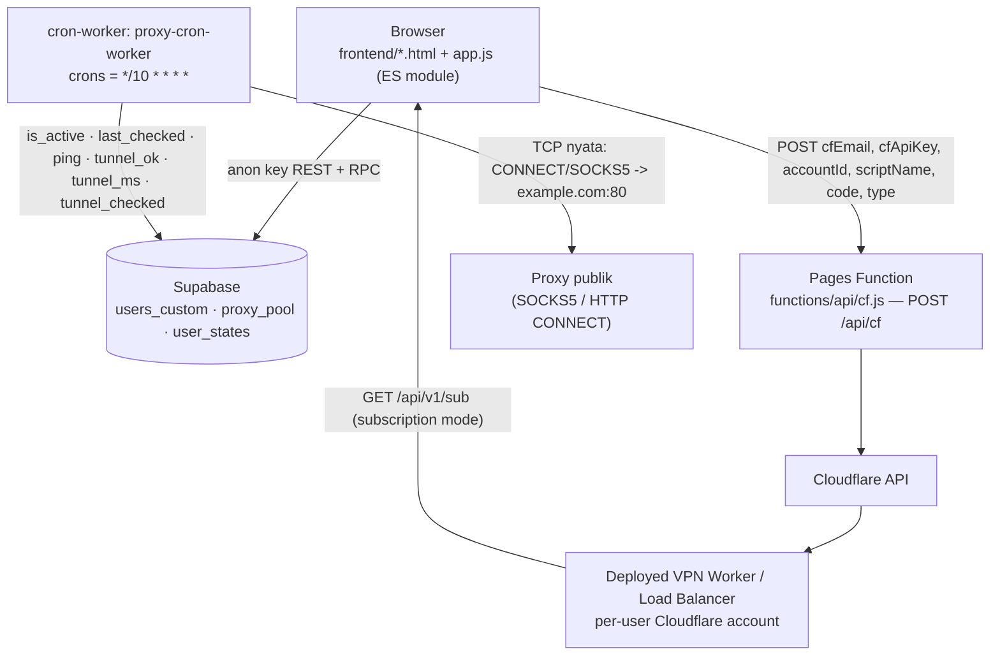

# Repository Guidelines

## Project Overview

`cfvpn-hub` (npm name `jhopan-sub-pages`) is a management panel for Cloudflare VPN (VLESS-over-WebSocket) Workers: deploy/monitor Workers and a Load Balancer, generate client configs (Raw / V2Ray base64 / Clash YAML / Sing-box), and curate the proxy pool the Workers route through.

- Live: https://cfvpn-hub-9xy.pages.dev (Pages project `cfvpn-hub` di akun Adelia — target deploy saat ini)
- Live lama: https://cfvpn-hub-dcx.pages.dev (akun Alan; tidak dipakai lagi)
- Repo: https://github.com/jhopan/cfvpn-hub — branch `main`. **Push ke `main` TIDAK memicu deploy**: integrasi Git Cloudflare Pages tidak aktif untuk project ini (dibuktikan 15 Nov — commit `a8f6abb` tidak punya status deploy Cloudflare, hanya check-run CI `Uji & cek sintaks`). Deploy = `npm run deploy` (wrangler direct upload, output dir `frontend`); setelah deploy, verifikasi isi aset di `https://cfvpn-hub-9xy.pages.dev` (`app.js` memuat versi terbaru) karena service worker bisa menyajikan salinan lama.
- No build step, no framework, no bundler. `frontend/` is uploaded verbatim.

Three independently deployed units:

| Unit | Config | Deploy |
|---|---|---|
| Pages project `cfvpn-hub` (frontend + `functions/api/cf.js`) | `wrangler.toml` | `npm run deploy` (akun Adelia — lihat “Deployment identity”); satu-satunya jalur deploy |
| Cron Worker `proxy-cron-worker` | `cron-worker/wrangler.toml` | manual `cd cron-worker && npx wrangler deploy` |
| Per-user VPN Workers / Load Balancer | `frontend/source/*.js` templates | panel Deploy page, or `deploy-bulk.mjs` |

## Architecture & Data Flow

Browser-only auth and state: the SPA talks to Supabase REST directly with the **anon key hardcoded in `frontend/app.js:3`**, and to Cloudflare only through the Pages Function.



- **Auth: client session + RPC server-side setelah SQL.** Session lives in `localStorage["CFVPN-vpn-panel-session"]` = `{username, role, hash?}` (`hash` = sha256 hex sandi, dipakai aksi admin). Protected pages carry an inline head guard `if(!localStorage.getItem("CFVPN-vpn-panel-session"))location.replace("landing.html")`; `checkAuth()` (`app.js:170`) re-enforces it, bounces authed users off `login.html`/`register.html` to `index.html`, and redirects non-admins off `admin.html` (role dibaca dari session, bukan dari DB). Sandi selalu SHA-256 hex (`hashPassword`).
  **Dua fase** (penting saat menyentuh auth): `sql/2026-11-14-auth-hardening.sql` memindahkan login/daftar/aksi admin ke RPC `SECURITY DEFINER` (`verify_login`, `register_user`, `admin_action`), mencabut SELECT tabel `users_custom` (hanya `username, role` yang di-grant per kolom) dan mencabut INSERT/UPDATE/DELETE mentah — server yang membandingkan hash dan memverifikasi pelaku admin, jadi anon key saja tidak bisa membaca hash atau membuat admin. **Panel baru tetap jalan tanpa SQL** (setiap jalur RPC jatuh kembali ke select/insert lama saat fungsinya tidak ada — `rpcMissing()` mencocokkan `PGRST202`); urutan aman: deploy panel dulu, baru jalankan SQL. Setelah SQL, jangan menambah `select("*")`/tulis mentah ke `users_custom` dari klien. SQL ini **sudah dijalankan di produksi** (2026-11-14) beserta migrasi kolom tunnel; setiap sesi lama tanpa `hash` harus login ulang sekali sebelum bisa melakukan aksi admin (panel menampilkan pesan "login ulang dulu"). **Dua lubang itu sudah ditutup, dengan dua berkas SQL baru** (manusia yang menjalankan):
`sql/2026-11-14-login-lockout.sql` mengunci brute force DI DALAM RPC (tabel `login_attempts` +
helper `login_lockout_locked/clear/fail`) sehingga pagar tetap berlaku walau PostgREST dipanggil
langsung tanpa lewat `/api/login`: 5 gagal → kunci 15 menit, berlipat 30/60 menit, ember hitungan
dipakai bersama oleh `verify_login` dan `whoami`; `whoami` mengembalikan `NULL` saat terkunci
(bukan error) supaya panel memperlakukannya sebagai hash tidak cocok. Berkas itu juga memuat
definisi `whoami(p_username, p_hash)` (SECURITY DEFINER, `grant execute` hanya ke `anon`) yang
dipakai panel untuk **memverifikasi sesi ke server** tiap muat halaman: hash tidak cocok → sesi
dihapus + dilempar ke `login.html`; RPC belum ada (`PGRST202`) atau sesi tanpa `hash` → perilaku
lama persis. Berkas `sql/2026-11-14-whoami.sql` sengaja TIDAK dipisah: dua berkas yang
mendefinisikan fungsi yang sama membuat urutan menjalankannya bisa menghapus lapisan kunci.
Gotcha yang ikut ditemukan saat itu: Cloudflare Pages meng-308 `/admin.html` → `/admin`, jadi
gerbang halaman berbasis `location.pathname === "admin.html"` **tidak pernah cocok** — `pageName()`
di `app.js` menormalkan ke bentuk `*.html` (dan `/index.html` → `/`).
Sisa yang masih fail-open: error RPC non-`PGRST202` (mis. jaringan mati) diperlakukan sebagai
"fungsi belum ada" supaya gangguan sesaat tidak mengunci pengguna; sesi dengan hash valid tapi
`role` dipalsukan di localStorage hanya dikoreksi, tidak dihapus; kunci bersifat per-username
(RPC tidak menerima IP), jadi penyerang masih bisa menebak banyak username berbeda.
- **Endpoint auth di Pages Function.** `POST /api/login` dan `POST /api/register` (`functions/api/login.js`, `register.js`, helper di `functions/api/lib/`) membatasi percobaan per IP (bawaan 10/600 s login, 5/600 s daftar; env `LOGIN_RATE_LIMIT`, `LOGIN_RATE_WINDOW_SEC`, `REGISTER_*`) **dan** memanggil `public.bump_rate` di Supabase untuk batas yang berlaku **global** (`sql/2026-11-14-ratelimit.sql`); kalau fungsi itu belum ada limiter global dilewati (tidak pernah memblokir). Panel mencoba endpoint ini dulu, lalu RPC langsung, lalu jalur lama — jadi deploy Functions dan SQL boleh berurutan.
- **State per user lewat RPC.** `user_states` tidak lagi bisa dibaca/ditulis anon (`sql/2026-11-14-state-hardening.sql`): `get_state`/`save_state` memverifikasi hash sandi pemilik, jadi sesi palsu di localStorage tidak bisa menimpa daftar worker orang lain. Panel memakai dua fase yang sama (RPC → select/upsert lama kalau RPC belum ada); batas 256 KB per state.
- **State.** `state` + `currentUser` are module globals in `app.js`; persistence is `user_states.state_data` (`emptyState` = `{generatedCount: 0, workers: []}`, worker = `{id, name, host, type: "vpn"|"load_balancer", active, source, uuid?, vpn_domains?}` (`uuid` = UUID yang dikunci saat deploy lewat binding `UUID_ALLOWLIST`; generator memakainya)), upserted `onConflict: "username"` (`app.js:187`). `localStorage` only holds the session plus 6-hour caches (`proxyActiveCountCache`, `proxyPickerCache`, `proxyListCache`).
- **Deploy path.** `deploy.html` collects the user's Cloudflare credentials → `app.js` fetches `/source/vpn-worker-free.js` \| `vpn-worker-prem.js` \| `load-balancer.js` (tier/type gated, `app.js:672-692`) → `POST /api/cf` → `functions/api/cf.js`: `stripComments(code)`, GET account subdomain, multipart PUT the script (`metadata.main_module`, `compatibility_date: "2024-05-12"`), POST enable subdomain → `{success, host, subdomain}` → `app.js:710` appends the worker to `state.workers` with `source:"cloudflare-auto"`.
- **Generator.** Local mode memuat `proxy_pool` (`ip,port,country,org,last_checked,ping` + `tunnel_ok,tunnel_ms` bila kolomnya ada — kalau PostgREST menolak, panel otomatis mengulang tanpa kolom itu) dan hanya menawarkan baris **segar** (`last_checked` < 6 jam, sama seperti filter worker) yang **belum pernah dinyatakan mati** oleh edge (`tunnel_ok !== false` — baris itu tidak pernah masuk daftar bukti maupun pilihan, walau `tls_ok`/`tunnel_host_ok` true). Bukti dibagi bertingkat di `proxyHealth()`: **edge** (`tunnel_ok === true`) → **host** (`tls_ok === true` atau `tunnel_host_ok === true`, ditulis panproxyscanner) → segar tanpa bukti; `preferred` memakai tingkat terbaik yang tersedia untuk filter itu, dan tiap baris diberi label `✓ edge N ms` / `✓ host N ms` / `✗ mati di edge`. Sebelum perbaikan 14 Nov, `preferred` bisa berisi 72 baris termasuk 42 yang mati di edge (semuanya `tls_ok = true`). Filter negara kini **multi-pilih** (`countrySelect multiple`, kosong = semua) dan baris `#countryStats` menampilkan jumlah segar/terverifikasi/terbukti mati per pilihan — nol proxy siap pakai memunculkan peringatan, bukan config yang diam-diam gagal. Centang **Mode rotasi** menghasilkan satu config ber-selector: path `/ALL` (tanpa filter) atau `/ID`, `/ID,SG` (semua negara terpilih) sehingga config tidak perlu diganti saat pool berubah. Subscription mode calls the LB Worker's `/api/v1/sub` with `cc`, `port`, `limit`, `format`, `tier`, `domains` and falls back to showing the manual URL on failure.
- **Pembersihan baris mati tidak lagi dari browser.** `functions/api/pool-purge.js` (POST `{username, hash}`) memverifikasi lewat RPC `whoami` (harus `admin`) lalu menghapus `proxy_pool?is_active=eq.false` memakai `env.SUPABASE_SERVICE_KEY`. Fail-closed: service key kosong -> 503 yang menyebut nama variabelnya, `whoami` belum ada (migrasi belum jalan) -> 409, hash salah -> 401. Tombol "bersihkan baris mati" di halaman proxy memanggil endpoint ini; `supabase.from("proxy_pool").delete()` dari browser sudah dihapus. Set secret: `npx wrangler pages secret put SUPABASE_SERVICE_KEY --project-name cfvpn-hub`.
- **Verifikasi proxy: probe tunnel adalah penentu.** `cron-worker` (`*/10`, 100 baris/siklus, 10 lane, deadline 25 s) menjalankan **satu** probe per baris aktif: `src/tunnel.js` (TCP → HTTP CONNECT lalu SOCKS5 → `GET example.com:80`, sukses = balasan memuat `HTTP/1.`) dan verdict itu **hanya dipakai untuk mematikan** (yang boleh menyalakan baris adalah `Pan-ProxyScanner`, sesuai aturan di repo itu) plus `ping` = `tunnel_ms` dan `tunnel_ok`/`tunnel_ms`/`tunnel_checked`. Kebijakan lama memakai cek ringan 5 detik sebagai penentu dan itu terbukti salah dua arah (terukur 2026-11-14: **15 baris terbukti tembus tapi dimatikan**, **7 baris aktif tapi terbukti mati**). Kolom tunnel dibutuhkan `sql/2026-11-14-proxy-tunnel-columns.sql`; sebelum SQL dijalankan siklus tetap jalan dengan kolom lama (satu warning per siklus, `isMissingColumnError` menangani `PGRST204`/`42703`). Batas per run: 60 baris, 6 lane paralel, deadline 18 s, anggaran 9 s per baris (penjaga keras: soket baris itu ditutup dan baris dicatat mati, karena alamat blackhole menggantung tanpa RST), giliran `tunnel_checked asc nulls first`. Baris yang dimatikan karena kegagalan sesaat dipulihkan oleh **scraper** (PATCH `is_active: true` setelah verifikasi TLS lolos) atau lewat `sql/2026-11-14-pool-recover-verified.sql`; status siklus terakhir bisa dibaca di `GET /status`. Bukti dianggap sah dari dua arah: `tunnel_ok = true` (probe cron dari edge) **atau** `tls_ok = true` (panproxyscanner, TLS terverifikasi). Query pool worker mencoba urutan `tunnel_ok,tls_ok,tunnel_ms,ping` lalu turun satu tingkat kalau kolom bukti belum ada (`POOL_ORDERS` + ingatan 5 menit).
- **Pipeline scraping produksi = `Pan-ProxyScanner` (Go, repo terpisah).** Jalan di Debian
  (`dist/panproxyscanner-linux-amd64`, website+API `:8787`, SQLite `proxies.db`), siklus otomatis
  **120 menit** (cap 1200, 150 job) dan mendorong hasil ke `proxy_pool` Supabase. Verifikasinya
  tiga tahap lewat tunnel: HTTP 80 `cdn-cgi/trace`, **TLS 443 dengan verifikasi sertifikat**, lalu
  port non-standar 8443/2053. Sumber yang kosong 3× dimatikan otomatis.
  Bukti yang dikirim: `tls_ok` (tunnel TLS 443), `alt_ok` (8443/2053), `exit_ip` (alamat keluar
  dari trace) — kolomnya disiapkan `sql/2026-11-14-proxy-evidence-columns.sql`, tanpa kolom itu
  aplikasi membuang hasilnya. Endpoint operasionalnya: `POST /api/supabase/push?limit=500` dan
  `POST /api/supabase/prune?days=1` (butuh policy DELETE anon dari SQL di atas). Panel+worker
  **wajib** menganggap `tls_ok = true` sebagai bukti yang setara dengan `tunnel_ok`.

- **Worker templates: satu kode, satu konstanta.** `vpn-worker-free.js` adalah **turunan** `vpn-worker-prem.js` dengan tepat satu baris berbeda: `const TIER_FREE = false;` (prem) vs `true` (free). Di free, `TIER_FREE` mematikan fitur premium yang butuh binding tambahan (relay UDP) — binding `RELAY_SERVER_UDP` diabaikan walau dipasang manual. Selain itu kode identik supaya perbaikan bug tidak tertinggal di satu tier. Edit **prem** saja lalu `npm run sync-templates` (menurunkan free); `tests/templates.test.mjs` + `tierCheck` di harness gagal kalau bedanya bukan cuma konstanta itu.
Saat mengubah template, naikkan **dua** penanda versi bersama-sama: `WORKER_VERSION` di
`frontend/source/vpn-worker-prem.js` dan `WORKER_TEMPLATE_VERSION` di `frontend/app.js`
(sekarang `2026-11-14a`); badge versi di panel membandingkan keduanya, jadi worker yang sudah
ter-deploy akan tampak "versi lain" — itu sinyalnya: worker lama harus di-deploy ulang supaya ikut
memakai urutan pool baru (verdict edge di depan bukti host).
  Alur data: the proxy target arrives in the WebSocket path `/<ip>-<port>` (IPv6 juga terbaca — port diambil dari kanan), TCP runs through the proxy, DNS (`cmd=2`, port 53) is answered by the Worker itself via DoH, dan UDP non-DNS ditutup cepat **kecuali** relay UDP dikonfigurasi (`RELAY_SERVER_UDP` → `proxy-relay/udp-relay.mjs`), karena Workers sendiri tidak punya UDP keluar. Detail yang penting untuk performa & kompatibilitas:
  - **Pool diurutkan dengan rantai empat tingkat**: `order=tunnel_ok.desc.nullslast,tls_ok.desc.nullslast,tunnel_host_ok.desc.nullslast,ping.asc.nullslast` → kalau ditolak: `tunnel_ok…,tls_ok…,ping…` → `tunnel_ok…,ping…` → `ping`. Tingkat bukti: edge (`tunnel_ok`), host TLS (`tls_ok`), tunnel host scanner (`tunnel_host_ok`, kolom baru), lalu ping. Verdict **edge** (`tunnel_ok`, dari cron-worker) sengaja di depan bukti **host** (`tls_ok` dari panproxyscanner) karena worker VLESS berjalan DI EDGE: pada pengukuran 14 Nov, 42 dari 72 baris aktif punya `tunnel_ok = false` walau `tls_ok = true`, jadi `tls_ok` lebih dulu akan menaikkan proxy mati. `tls_ok` hanya menentukan urutan untuk baris yang belum pernah diprobe edge. Kegagalan urutan diingat 5 menit per isolate (`counters.poolOrder`) dan tidak pernah menggagalkan pengambilan pool.
  - **`/health` bisa digerbang**: kalau `env.HEALTH_TOKEN` diisi, `/health` hanya menjawab dengan `?token=<nilai>` atau header `x-health-token` (401 tanpa itu). Panel tidak mengirim token, jadi badge versi worker di dasbor berhenti muncul bila gating diaktifkan; `/myip` tetap terbuka.
  - **Endpoint DoH berantai**: `env.DOH_ENDPOINT` → `env.DOH_FALLBACK` (kalau salah satu diset, HANYA itu yang dipakai) → bawaan `1.1.1.1/dns-query` lalu `dns.google/dns-query`. Kalau semua gagal, klien menerima **SERVFAIL** (bukan diam sampai timeout).
  - **Cache DoH per-isolate** (`dnsCache`): kunci = nama+tipe+kelas (tanpa txid, huruf kecil), TTL dari catatan pertama dijepit 30..600 detik, maksimal 256 entri; txid balasan ditulis ulang sesuai pertanyaan. Ini memotong subrequest `fetch` untuk domain yang diulang dalam satu penjelajahan.
  - **Mux.cool (Xray Mux)** didukung: `cmd=3` di header VLESS diperlakukan sebagai koneksi mux (klien tidak mengirim alamat di header; cmd=3 sendiri penandanya, jadi tidak perlu tebak-tebakan). Format frame diverifikasi dari klien Xray **asli** — caranya: server VLESS-WS sementara yang hanya mencetak hex apa yang dikirim klien (`WebSocketServer` dari paket `ws` yang sudah ada di `node_modules`), jalankan Xray dengan `mux.enabled=true` menunjuk ke server itu, lalu baca dump-nya. Hasilnya: `[2B metaLen][meta][2B dataLen][data]` (dua byte panjang data hanya ada kalau opt punya bit 0x01), meta = `[2B id][1B status][1B opt]` plus, untuk New, `[1B network][2B port][1B atyp][addr]` (+8 byte Global ID untuk XUDP). Status: 1=New, 2=Keep, 3=End, 4=KeepAlive. Tiap sub-koneksi TCP membuka tunnel sendiri ke proxy (dengan failover), XUDP hanya melayani DNS lewat DoH, dan `env.MUX=off` mematikan jalur ini. Catatan penting: potongan setelah frame pertama **tidak boleh** di-parse ulang sebagai header VLESS — pernah menjadi bug nyata (koneksi mux ditutup begitu klien memakai koneksi utama untuk request kedua).
  - **UDP non-DNS lewat relay sendiri** (`proxy-relay/udp-relay.mjs`): Cloudflare Workers tidak punya UDP keluar, jadi datagram UDP selain DNS diteruskan ke proses relay lewat TCP (`udp <alamat> <port> <rahasia>\n` lalu `[2B panjang][payload]` dua arah) dan relay itu yang mengirim UDP nyata. Aktif hanya kalau env `RELAY_SERVER_UDP` (+ `RELAY_SERVER_PORT`, `RELAY_SERVER_TLS`, `RELAY_SECRET`) diisi; tanpa itu perilakunya tetap seperti sebelumnya (ditutup cepat). Relay **wajib** memakai `RELAY_SECRET` — relay terbuka = alat refleksi UDP. DNS tetap dijawab worker lewat DoH (lebih cepat daripada lewat relay). Ini menghidupkan kembali pola template lama (`RELAY_SERVER_UDP` di `vpn-worker-prem` 500c12f, pasangan `udp-relay.hobihaus.space` di template free) yang kedua relay-nya sudah mati, dengan perbaikan: satu koneksi relay per sesi UDP (bukan satu koneksi per datagram), autentikasi rahasia, batas ukuran datagram, sweep idle, dan guard supaya satu sesi jelek tidak menjatuhkan proses. Detail operasional ada di `proxy-relay/README.md`.
  - **Halaman Deploy bisa memasang env (binding) — khusus tier Premium**: form Deploy punya bagian "Relay UDP (opsional)" (`relayHost`, `relayPort`, `relayTls`, `relaySecret`) yang hanya tampil untuk worker VPN bertier Premium; non-admin selalu Free sehingga tidak pernah melihat maupun mengirimnya (`currentDeployTier()` + `collectRelayVars()` di `app.js`). `functions/api/cf.js` memvalidasi `vars` lewat `normalizeVars` (nama `^[A-Za-z_][A-Za-z0-9_]{0,63}$`, nilai maksimal 1024 karakter, maksimal 12 pasangan, nilai kosong dilewati) lalu memasangnya sebagai binding `plain_text` saat upload. Catatan jujur: auth panel sepenuhnya client-side, jadi `/api/cf` sendiri tidak bisa memverifikasi tier — pengaman sebenarnya adalah `RELAY_SECRET` di relay (tanpa rahasia itu worker mana pun tidak bisa memakai relay operator). Bentuk binding `plain_text` terbukti diterima Cloudflare: worker uji memakai binding `FALLBACK_POOL` dan `/health` melaporkan `fallback_pool: true`. `deploy-bulk.mjs` memakai env shell dengan nama sama (`RELAY_SERVER_UDP` wajib disertai `RELAY_SECRET`). Di form yang sama ada isian **UUID WORKER**: kalau diisi, panel mengirim `UUID_ALLOWLIST` (divalidasi di client dan di `normalizeVars`), menyimpannya di `state.workers[].uuid`, dan generator memakai UUID itu (bukan UUID acak) supaya konfigurasi klien cocok dengan worker yang terkunci.
  - **Query identik yang sedang jalan berbagi satu panggilan DoH** (`dnsInflight`): beberapa koneksi ke domain yang sama sering dibuka bersamaan; tiap pemanggil tetap menerima balasan dengan txid-nya sendiri.
  - **Protokol proxy diingat per `host:port`** (`proxyProtocols`, maks 64 entri): proxy HTTP-only tidak lagi membayar satu koneksi + satu round trip SOCKS5 di setiap koneksi berikutnya. Probing greeting SOCKS5 dibatasi `SOCKS5_PROBE_TIMEOUT` (2,5 s) supaya proxy yang diam saja tidak menahan 8 detik; sisa tahap handshake tetap 8 detik.
  - **Writer ke soket proxy ditahan selama tunnel hidup** (`writeToRemote`) — tidak ada lagi `getWriter()`/`releaseLock()` untuk setiap potongan data dari klien; setelah target menutup, state dilepas supaya potongan berikutnya tidak menulis ke soket mati.
  - **Failover proxy (bukan rotasi)**: kalau proxy di path gagal, worker mencoba cadangan dari `env.FALLBACK_PROXIES` lalu (kecuali `env.FALLBACK_POOL=off`) 16 baris teratas `proxy_pool` dari Supabase — daftar itu di-cache 120 detik per isolate dan dihangatkan di latar belakang saat koneksi mulai. Maksimal `FALLBACK_MAX` (3) percobaan; proxy utama tetap dipakai selama sehat, jadi IP keluar bisa berbeda dari yang tertulis di URI klien saat failover aktif. Sebelum pindah ke cadangan, proxy yang sama dicoba **sekali lagi** setelah 180 ms (handshake gagal karena paket hilang sering lolos di percobaan kedua) — hitungannya `counters.proxyRetry` di `/health`. **Hedge, bukan pemendekan timeout:** proxy utama dicoba dengan timeout normal, tetapi kalau belum selesai setelah `HEDGE_DELAY_MS` (1,5 s) jalur cadangan mulai berjalan paralel dan tunnel pertama yang selesai "mengklaim" koneksi (yang kalah menutup soketnya sendiri). Ini penting: memendekkan timeout proxy utama pernah dicoba dan justru *meregresi* proxy lambat-tapi-sehat (terukur di edge: probe 6 proxy turun dari 5/6 ke 4/6); dengan hedge, alamat yang pasti mati (`192.0.2.1:1080`) dilayani cadangan dalam 3,9 s sedangkan sebelum ada failover gagal di 8,7 s. Anon key Supabase hardcoded di template, sama seperti `load-balancer.js`; endpoint pool bisa dialihkan lewat `FALLBACK_POOL_URL`.
  - **Selector di path** (memilih proxy dari sisi klien): `/<ip>-<port>` atau `/<ip>:<port>` = proxy itu; `/ALL`, `/ROTATE`, `/AUTO`, `/POOL` = pilih acak dari `ROTATE_POOL_LIMIT` (6) proxy teratas pool; `/<CC>` seperti `/ID` atau `/SG`, boleh banyak (`/ID,SG` atau `/US-ID`) = hanya negara itu, pilih acak dari teratas. `parseSelector()` yang memutuskan, dan cache pool kini **per-filter** (`poolCache` key `all` atau `ID,SG`) sehingga beberapa selector tidak saling menimpa; `FALLBACK_PROXIES` hanya dipakai untuk selector **tanpa** filter negara (isinya tidak punya label negara). Selector negara **gagal-tertutup**: kalau negara itu tidak punya proxy sehat, koneksi ditutup (`counters.rotateEmpty`) dan cadangan dari negara lain tidak dipakai — IP keluar adalah alasan filter itu dipakai, jadi keluar dari negara lain tanpa bilang lebih buruk daripada gagal; kandidat cadangan pun ikut difilter. `counters.rotateUsed` menghitung koneksi ber-selector yang berhasil memilih proxy.
  - **Watchdog idle/half-open** (`IDLE_CLOSE_SECONDS`, bawaan 180, `0` = mati): kalau klien sudah mengirim data tetapi tidak ada data dari target selama N detik, koneksi ditutup dengan kode 1001 "target tidak menjawab" — proxy "setengah mati" tidak lagi menggantung sampai CDN yang memutus.
  - **Cache DNS berlapis** (`DNS_CACHE_MODE`: `both` bawaan, `memory`, `cache`, `off`): Map per-isolate dulu, lalu Cache API (kunci `/__dnscache__/<nama+tipe+kelas>` di host worker sendiri; hasil dari Cache API dipromosikan ke memori). Jawaban negatif (NXDOMAIN/NODATA) di-cache 30 detik; SERVFAIL dan jawaban terpotong tidak di-cache. Hitungan hit/miss per lapisan muncul di `/health`.
  - **Query DNS dalam satu frame dikerjakan paralel** dan balasan dikirim begitu siap (urutan datagram tidak dijamin — sama seperti UDP asli; klien mencocokkan lewat txid, dan `tests/smoke-vpn-worker.mjs` menguji secara order-agnostic).
  - **Alamat tujuan numerik dikirim sebagai ATYP 1 (IPv4) / 4 (IPv6)** di permintaan SOCKS5, bukan sebagai domain, supaya proxy tidak perlu resolusi sendiri; pada HTTP CONNECT, IPv6 ditulis `[addr]:port` (request line + `Host`).
  - **Header balasan VLESS (2 byte) dikirim begitu tunnel siap**, tidak menunggu byte pertama dari target.
  - Early data lewat `sec-websocket-protocol` tetap didukung; `Upgrade` dibandingkan tanpa peduli besar-kecil huruf.
  Configuration enters only via Cloudflare `env` (`REVERSE_PRX_TARGET`, optional `UUID_ALLOWLIST`, `DOH_ENDPOINT`/`DOH_FALLBACK`). `load-balancer.js` embeds the Supabase REST URL + anon key (`load-balancer.js:5-6`), so the anon key ships inside every deployed LB Worker.

## Key Directories

| Path | Purpose |
|---|---|
| `frontend/` | Cloudflare Pages output; served verbatim |
| `frontend/app.js` | The whole SPA (ES module, ~1130 lines) — auth, nav, dashboard, workers, generator, deploy, proxy pool, admin |
| `frontend/*.html` | 9 pages: `index` (dashboard), `landing` (public), `login` (login+register tabs), `register` (redirect stub to `login.html#register`), `workers`, `generator`, `proxy`, `deploy`, `admin` |
| `frontend/source/` | VPN Worker + Load Balancer templates uploaded by the deploy flow |
| `frontend/sw.js`, `frontend/manifest.json` | PWA service worker and manifest |
| `functions/api/cf.js` | Pages Function → `/api/cf`, proxies Cloudflare API with creds from the request body |
|`cron-worker/`|Separate Worker: proxy health checker (`src/index.js`), own `package.json`/lockfile. **Hanya mengawasi `is_active=true` dan boleh mematikannya saja — tidak pernah menyalakan** (cek dangkal 5 s bisa lolos di proxy non-TLS, dan verifikasi mendalam `proxy-scraping` yang berhak menaikkan baris)|
| `proxy-scraper/` | Local CLI (jalur **uji/dev**; pipeline produksi = `Pan-ProxyScanner`): 55 sumber (52 aktif) → ~160k kandidat unik → dedupe → filter port terbuka → verifikasi 2 tingkat (**TCP handshake + GET 204 port 80**, lalu **TLS 443 lewat tunnel** via `tls-trace.mjs` yang juga mengambil negara keluar dari `cdn-cgi/trace`) → tulis ke `proxy_pool` (`sources.mjs`, `sources-check.mjs`, `node-socket.mjs`, `index.mjs`) |
| `deploy-bulk.mjs` | Local interactive batch deploy/status/delete menu for Worker templates |
| `tests/` | `node:test` suite (`deploy-vars`, `cf-guard`, `cron-tunnel`, `templates`) + smoke harness `smoke-vpn-worker.mjs` + klien uji jalur nyata (`prod-vless-dns.py`, `prod-proxy-check.py`, `vless_ws.py`) — lihat Testing & QA |
| `sql/` | Migrasi yang **dijalankan manusia** (agent menyiapkan berkasnya): `2026-11-14-proxy-tunnel-columns.sql`, `2026-11-14-tunnel-host-columns.sql` (bukti vantage host dari panproxyscanner), `2026-11-14-auth-hardening.sql`, `2026-11-14-state-hardening.sql`, `2026-11-14-login-lockout.sql` (kunci brute force + definisi `whoami`), `2026-11-14-ratelimit.sql`, plus `2026-11-14-pool-prune-index.sql` (index + prune) dan `2026-11-14-pool-recover-verified.sql` (pemulihan sekali jalan), `2026-11-15-pool-prune-service-key.sql` (mencabut DELETE anon pada `proxy_pool`; prune pindah ke service key), serta berkas `*-rollback.sql` untuk dua migrasi hardening |
| `functions/api/lib/` | Helper bersama Functions: klien Supabase REST (anon), rate limit (Cache API + `bump_rate` global), respons JSON |
| `scripts/` | `sync-templates.mjs` — menurunkan `vpn-worker-free.js` dari `vpn-worker-prem.js` (beda tepat satu baris: `TIER_FREE`); `deriveFree()` diekspor untuk tes, `--check` dipakai `npm test` |

## Development Commands

```bash
npm install                                   # root deps (wrangler + @supabase/supabase-js + playwright)
npm run dev                                   # wrangler pages dev frontend --compatibility-date=2024-05-12
npm run deploy                                # wrangler pages deploy frontend (akun Adelia; flag --compatibility-date TIDAK didukung untuk `pages deploy` di wrangler 4.118)
nrun node --check frontend/app.js             # mandatory syntax gate after editing app.js
nrun node deploy-bulk.mjs                     # operator batch menu (reads workers.txt, writes deployed.txt/status.txt)
npm test                                       # node --test "tests/*.test.mjs" (deploy-vars, cf-guard, cron-tunnel, templates)
npm run sync-templates                         # turunkan free dari prem (wajib setelah menyentuh template worker)
npm run check:templates                        # gagal kalau free bukan turunan prem
cd cron-worker && npm install && npx wrangler deploy   # cron worker (deploy manual)
nrun node proxy-scraper/index.mjs             # scrape multi-sumber + verifikasi 2 tahap, tulis yang hidup ke proxy_pool
nrun node tests/smoke-vpn-worker.mjs          # 38 skenario WS/VLESS (lihat Testing & QA)
```

Local dev serves `http://localhost:8788` (wrangler Pages default).

## Deployment Identity

Deploy target sekarang **akun Adelia**, bukan akun Alan.

| Item | Nilai |
|---|---|
| Identitas wrangler | OAuth `adelia140845@gmail.com`, account `f8ab047719232d46d2185cbc6655dee3` — token di `C:\Users\ACER\.wrangler\config\default.toml` |
| Pages project | `cfvpn-hub` → https://cfvpn-hub-9xy.pages.dev (semua halaman 200 di path extensionless; `*.html` 308 → extensionless, sama seperti situs lama) |
| Akun lama | Alan `alantampan1203@gmail.com` / `cd15e050fa56faa61e6b796b3c4e41e5` — kredensialnya sudah dikomentari di `.env`, jangan diaktifkan lagi |

Kredensial wrangler dibaca berlapis: env var `CLOUDFLARE_API_KEY`+`CLOUDFLARE_EMAIL` > `--env-file` > `.env` di cwd > OAuth. Karena itu `.env` **tidak boleh** lagi memuat `CLOUDFLARE_*` (barisnya dikomentari); Supabase URL/anon key di sana tetap dipakai sebagai dokumentasi.

Gotcha: `wrangler pages` menyimpan `account_id` + `project_name` di `.wrangler/cache/pages.json`. Kalau akun berganti, hapus file itu dulu — kalau tidak, perintah Pages menembak akun lama dan gagal `Authentication error [code: 10000]`.

```bash
npx wrangler whoami                 # pastikan adelia140845@gmail.com
rm .wrangler/cache/pages.json       # hanya kalau akun barusan diganti
npx wrangler pages project list
npm run deploy
npx wrangler logout / npx wrangler login    # ganti identitas OAuth
```

Supabase CLI: `supabase@3.1.0`. Login aktif = akun **adelia140845@gmail.com** (token di Windows keyring; `~/.supabase` tidak menyimpan file token). Project panel sekarang **`lumbbmhhmkcnxunuryjr`** (org `Adelia Hub`, region `ap-southeast-1`), dibuat 2026-11-12 lewat `supabase projects create`; skemanya ada di `supabase/schema.sql`. Perintah yang terbukti jalan di mesin ini:

```bash
npx supabase@latest whoami
npx supabase@latest orgs list --output-format json
npx supabase@latest projects list --output-format json
npx supabase@latest projects api-keys --remote=<ref> --reveal --yes
npx supabase@latest db query --remote=<ref> -f supabase/schema.sql --yes    # jalankan SQL tanpa psql
```

Project lama `cgflrpjavyotvolnvcnl` (anon-key-only, bukan milik akun ini) tidak lagi dipakai; kuncinya tidak bisa dipakai untuk DDL karena tidak ada service key/token di akun itu.

**Catatan deploy worker di mesin ini (penting).** `wrangler deploy` sering crash di sini dengan `Assertion failed: !(handle->flags == UV_HANDLE_CLOSING), file src\win\async.c, line 76` — kadang setelah upload, kadang sebelum — dan deploy yang gagal bisa meninggalkan worker dalam keadaan **500 untuk semua request, apa pun kodenya** (terbukti: kode trivial pun 500). Dua hal yang terbukti menyelesaikannya:

1. Deploy worker uji lewat **API langsung** dengan token OAuth dari `~/.wrangler/config/default.toml`: `PUT /accounts/{acc}/workers/scripts/{name}` multipart (`metadata` JSON berisi `main_module`, `compatibility_date`, `bindings`; satu part berisi kode dengan content-type `application/javascript+module`), lalu `POST /accounts/{acc}/workers/scripts/{name}/subdomain` dengan `{"enabled":true}` — tanpa langkah subdomain, worker baru menjawab 404.
2. Kalau worker tetap 500 untuk **semua** request, **hapus lalu buat ulang** worker itu (`DELETE .../scripts/{name}` → unggah lagi → enable subdomain). Ini yang memulihkan `vpn-worker-prem` setelah deploy `wrangler` yang crash. Token OAuth di `default.toml` berumur pendek: jalankan `npx wrangler whoami` dulu supaya tersegarkan sebelum memakai API langsung.

## Code Conventions & Common Patterns

- **No bundler.** `app.js` is an ES module with exactly one import — `https://cdn.jsdelivr.net/npm/@supabase/supabase-js/+esm` (`app.js:1`) — and no exports. Never add a bare-module import; use full CDN URLs or relative paths. All 8 non-stub pages load it as `<script type="module" src="app.js">`.
- **Encoding trap.** `app.js` must be UTF-8 **without BOM**; a BOM produces `SyntaxError: Unexpected token '}'`. Same for other shipped JS.
- **Naming.** JS/identifiers camelCase; DOM ids camelCase and feature-first (`deployTier`, `proxyTableBody`, `addAdminForm`, `subLimitInput`). Supabase columns stay snake_case (`password_hash`, `is_active`, `last_checked`, `state_data`) — never rename one side to “fix” the mismatch.
- **DOM/dependency pattern.** No framework: each page declares its own markup, and `app.js` renders by `innerHTML` template strings + `escapeHtml` (`app.js:205`) for user data. Use data attributes for delegated events (`data-toggle-role`, `data-delete-user`, `dataset.editId`). `renderNav()` is the single place that reveals admin UI.
- **Role gating = hide, don't merely disable.** `renderNav` (`app.js:225-266`) unhides `.admin-toolbar` / admin nav and the premium tier option only for `currentUser?.role === "admin"`; non-admins must be forced to `vpn-worker-free.js`.
- **Fungsi handler shape.** `onRequest(context)` only; **sebelum** apa pun: gerbang Origin opsional (`env.ALLOWED_ORIGINS`, kosong = mati) lalu rate limit per IP lewat Cache API (bawaan 10 permintaan / 600 s per IP, `env.RATE_LIMIT` / `env.RATE_WINDOW_SEC`; 429 + `Retry-After`), lalu reject non-POST with 405 JSON; validate required fields → 400 `{error}`; success → `{success: true, ...}`; unexpected → 500 `{error: error.message}`; Cloudflare auth via `X-Auth-Email`/`X-Auth-Key`. Rate limit Cache API bersifat **per-colo dan best-effort** (bukan global); batas **global** datang dari `public.bump_rate` di Supabase (`sql/2026-11-14-ratelimit.sql`) yang dipanggil setelah prefilter Cache API — kalau panggilan itu gagal atau fungsinya belum ada, permintaan **tidak** diblokir (hanya dicatat), supaya migrasi yang belum dijalankan tidak mematikan deploy.
- **Template worker: dua berkas, satu isi.** `frontend/source/vpn-worker-free.js` must stay byte-identical to `vpn-worker-prem.js` (tier difference = env at deploy time). Edit `-prem.js` only, then run `npm run sync-templates`; `npm test` fails when they drift.
- **Cache busting.** Bump `CACHE_NAME` in `frontend/sw.js` (sekarang `cfvpn-hub-v14`) whenever a cached asset changes, or users keep the old copy. Sejak v11 `/source/*.js` memakai **network-first**: template diambil `app.js` lewat `fetch()`, jadi `destination`-nya kosong dan tanpa aturan itu ia jatuh ke cache-first (template basi ikut ter-upload saat deploy).
- **Worker upload TANPA komentar (penting).** `frontend/source/*.js` dikirim ke API Cloudflare lewat `functions/api/cf.js` / `deploy-bulk.mjs`, dan keduanya **wajib** melewatkan kode ke `stripComments()` (`functions/api/strip-comments.js`) sebelum upload. Bukti terukur (12 Nov): source apa adanya (23.094 byte, 28 baris komentar) → Worker hidup 1 request lalu `500 / error 1101` selamanya; source yang sama setelah komentar dibuang (21.271 byte) → `200` ×12 selama 96 detik + tunnel VLESS 3/3 PASS. `wrangler deploy` tidak pernah kena karena esbuild membundel tanpa komentar. Jangan kirim `code` mentah ke endpoint upload.
- **Error handling.** `async/await` everywhere; wrap Supabase/fetch in `try/catch`; surface user-facing text through `setMessage(id, message, error)` (`app.js:208`); `console.*` for diagnostics. Silent `.catch(() => {})` only for non-critical paths (SW install, subdomain enable, cache prefetch).
- **Timeouts.** Network guards use explicit limits — `AbortSignal.timeout(15000)` for LB subscription fetches, 5 s for per-proxy health checks.
- **Comments/UI copy are Indonesian** (`// Diganti checkAuth()`, `Tidak ada …`); comments in `cf.js` from earlier drafts are stale — trust behaviour over comments.
- **Cache busting.** Bump `CACHE_NAME` in `frontend/sw.js` (sekarang `cfvpn-hub-v14`) kalau ada aset cache berubah; tanpa itu pengguna memakai salinan lama.
- **Compatibility date lives in two places** and must stay in sync: `wrangler.toml` and the upload metadata in `functions/api/cf.js`. `wrangler pages deploy` rejects `--compatibility-date` in wrangler 4.118 (`wrangler pages dev` still accepts it), so the npm `deploy` script must not pass that flag.

## Important Files

| File | Why it matters |
|---|---|
| `frontend/app.js` | Single source of client behaviour; every feature lives here |
| `frontend/index.html` … `admin.html` | Head guard, nav, form ids that `app.js` queries by id |
| `functions/api/cf.js` | Only server route; Origin/rate-limit guard → validates `{cfEmail, cfApiKey, accountId, scriptName, code, type, vars?}` → uploads the Worker (vars → binding `plain_text` lewat `normalizeVars`) |
| `sql/*.sql` | Migrasi untuk dijalankan manusia: kolom tunnel (`tunnel_ok`/`tunnel_ms`/`tunnel_checked`) dan auth hardening (RPC + cabut SELECT/tulis mentah `users_custom`) |
| `scripts/sync-templates.mjs` | Penjaga invarian: `vpn-worker-free.js` = `vpn-worker-prem.js` |
| `frontend/source/vpn-worker-free.js` / `vpn-worker-prem.js` | Byte-identical VLESS-over-WS templates: TCP via proxy (SOCKS5 ATYP 1/4 untuk IP numerik → fallback HTTP CONNECT), DNS via DoH berantai + cache per-isolate (SERVFAIL kalau semua endpoint gagal), UDP lain ditutup cepat |
| `frontend/source/load-balancer.js` | Subscription API `/api/v1/sub`; embeds Supabase URL + anon key |
| `cron-worker/src/index.js` + `cron-worker/wrangler.toml` | Proxy health loop, `*/10 * * * *` (100 baris/siklus, 10 lane, deadline 25 s), `/trigger` fetch hook |
| `deploy-bulk.mjs` | Operator TUI: deploy/status/delete Workers; needs `CF_EMAIL`/`CF_API_KEY`/`CF_ACCOUNT_ID` |
| `wrangler.toml`, `package.json` | Pages config, output dir, npm scripts |
| `README.md` | Indonesian end-user docs incl. the Supabase SQL schema (only place it exists — there are no `.sql` files or migrations) |

## Runtime/Tooling Preferences

- **Runtime:** Node (npm, `package-lock.json` in root, `cron-worker/`, `proxy-scraper/`). No Bun anywhere. `wrangler` is pinned to `latest`, so CLI behaviour can drift.
- **Shell:** Hermes terminal is **WSL2 bash**, not Git Bash → Windows paths are `/mnt/c/Users/ACER/...` (never `/c/...`). `node` is absent from the WSL PATH: use the wrapper `nrun node <file>` (`/mnt/c/Users/ACER/bin/nrun`).
- **Path literals in JS/`.mjs` files are native Windows** (`C:/Users/ACER/...`).
- **Deploy rule:** never `wrangler deploy` the frontend — that ships a Worker. Use `npm run deploy` (Pages) or the cron Worker's own directory.
- **Secrets.** `.env` is gitignored and *no repo code reads it* (no dotenv), **but wrangler itself loads it** from the working directory — the `CLOUDFLARE_*` lines are deliberately commented out there so wrangler falls back to the Adelia OAuth login instead of a global API key. `deploy-bulk.mjs` still expects `CF_EMAIL`/`CF_API_KEY`/`CF_ACCOUNT_ID` (never present). Supabase URL/anon key are hardcoded in `frontend/app.js:2-3`, `cron-worker/src/index.js:16-17`, `proxy-scraper/index.js:4-5`, `frontend/source/load-balancer.js:5-6`.
- **Cloudflare API keys must never enter the frontend or `frontend/source/`**; the panel deliberately accepts a user-supplied key per deploy request and forwards it through `/api/cf`.
- Repo hygiene: artefak uji Xray/VLESS (`.xray-*.json`, `.vless-url.txt`, `.test-candidates.sh`, `vless-id.yaml`, `test-xray-vless.json`) memuat UUID/host hidup dan **sudah masuk `.gitignore`**; `test-xray-vless.json` yang sempat ter-commit sudah dihapus dari tree (jejaknya masih di riwayat git — kalau UUID di berkas itu pernah dipakai untuk config nyata, rotasi UUID-nya). Jangan menambah berkas semacam itu; gitignore dulu kalau perlu.

## Testing & QA

- **Framework:** Node's built-in `node:test` + `node:assert/strict`. `npm test` menjalankan `node --test "tests/*.test.mjs"`; pola glob di-expand Node sendiri (shell Windows tidak meng-expand `*.mjs`), sedangkan `node --test tests/` (direktori) gagal MODULE_NOT_FOUND di Node 24 — jangan pakai bentuk itu. **CI ada** di `.github/workflows/ci.yml` (Node 22, `npm test` + `npm run check:templates` + loop `node --check`; harness smoke sengaja tidak dijalankan karena butuh wrangler/port/jaringan). Tidak ada ESLint/Prettier; `playwright` masih devDependency tapi tidak dipakai.
- **Suite unit (semua lulus 2026-11-15, 63 uji; termasuk `tests/pool-purge.test.mjs` dengan 11 uji baru untuk endpoint purge):** `tests/deploy-vars.test.mjs` (7 — `normalizeVars` di `cf.js`), `tests/cf-guard.test.mjs` (19 — IP klien, parsing pola `ALLOWED_ORIGINS`, kunci/jendela rate limit), `tests/cron-tunnel.test.mjs` (11 — byte SOCKS5/CONNECT, parser balasan, deteksi `HTTP/1.` terpecah, kolom hilang, `probeTunnel` dengan soket palsu), `tests/templates.test.mjs` (1 — free = turunan prem, hanya `TIER_FREE` berbeda), `tests/auth-endpoints.test.mjs` (endpoint `/api/login` & `/api/register` dengan `fetch` di-stub: 405/400/401/409/429/503 + limiter global gagal tidak memblokir).
- **Uji non-`node:test`:** `tests/smoke-vpn-worker.mjs` (harness WS/VLESS), `tests/check-proxy.mjs` (logika checker cron), `tests/prod-vless-dns.py` + `tests/prod-proxy-check.py` + `tests/vless_ws.py` (jalur nyata ke worker ter-deploy).
- **Static checks that do apply:** `nrun node --check frontend/app.js` (syntax gate) and `nrun node --check` on any file you touch.
- **Uji validasi env deploy:** `nrun node --test tests/deploy-vars.test.mjs` — menguji `normalizeVars` dari `functions/api/cf.js`: env kosong berarti tanpa binding, nilai kosong dilewati, relay lengkap menjadi empat binding `plain_text`, nama tidak valid / nilai terlalu panjang / jumlah berlebih / format bukan objek ditolak dengan pesan jelas. Ini satu-satunya logika baru di `cf.js`.
- **Worker smoke test (jalur WS/VLESS + DNS/DoH):** `nrun node tests/smoke-vpn-worker.mjs` — menjalankan `frontend/source/vpn-worker-prem.js` lewat `wrangler dev` lokal dengan `[vars] DOH_ENDPOINT` diarahkan ke stub DoH `127.0.0.1:7303` (isinya byte-identik dengan file di repo), lalu memeriksa **38 skenario** (fungsi skenario 45 kali; termasuk gerbang `/health` dengan `HEALTH_TOKEN`, rantai urutan pool 4 tingkat (`tunnel_ok`->`tls_ok`->`tunnel_host_ok`->`ping`, tiga langkah fallback) dengan satu stub pool yang bisa menyembunyikan kolom per skenario, selector `/ALL`/`/SG`/`/XX` gagal-tertutup, dan batching dengan pembanding relatif): framing UDP `[2B panjang][query]` dan varian polos, header respons VLESS 2 byte, header yang terpecah antar frame, dua datagram dalam satu frame (urutan balasan bebas), penutupan cepat untuk UDP non-53, jalur TCP lewat proxy, penutupan socket, ATYP numerik SOCKS5 (`05010001...` untuk IPv4, `05010004...` untuk IPv6), kurung siku pada `CONNECT [ipv6]:443`, cache DoH (query sama diulang tidak memanggil DoH lagi tapi txid tetap diperbarui), protokol proxy diingat (`proxyProtocolOrder`: koneksi kedua ke proxy HTTP-only tidak mencoba SOCKS5), query DNS identik bersamaan (satu panggilan DoH, dua balasan ber-txid sendiri), UUID di luar `UUID_ALLOWLIST` ditolak, **failover** (proxy utama mati di port 7307 → cadangan dari `FALLBACK_PROXIES` dipakai) dan kebalikannya (proxy sehat → cadangan tidak dipakai), **failover dari pool** (worker dengan `FALLBACK_POOL_URL` menunjuk REST palsu di 7309: daftar ditunggu lalu dipakai), **cache DNS negatif** (NXDOMAIN tidak di-query ulang), `/health` melaporkan hitungan isolate, **Cache API** (worker dengan `DNS_CACHE_MODE=cache`: query kedua dilayani cache bersama tanpa DoH), fallback DoH (endpoint utama sengaja mati → `DOH_FALLBACK`), SERVFAIL saat semua endpoint DoH mati, **watchdog** (worker dengan `IDLE_CLOSE_SECONDS=1`: proxy di port 7308 handshake sukses tapi diam → koneksi ditutup dalam ~1 detik), dan bahwa free dan prem identik. Stub: 7301 dial-langsung, 7302 & 7306 proxy penolak-SOCKS5 (yang kedua untuk menguji memo protokol), 7303 DoH (nama berawalan `nx` dijawab NXDOMAIN), 7304 proxy SOCKS5 penerima no-auth, 7308 proxy "setengah mati", 7309 REST `proxy_pool` palsu, 7311 proxy HTTP-only yang diam terhadap SOCKS5, 7312 proxy yang mengirim 20 potongan 256 B. 7313 relay UDP (`proxy-relay/udp-relay.mjs`) + 7314 UDP echo. Skenario tambahan di luar daftar di atas: **early data lewat `?ed=`** (tanpa pesan WS), **race protokol** untuk proxy yang belum dikenal, **batching WS** (aktif vs `WS_BATCH_MS=0`), **mux (cmd=3)** dua sesi berturut-turut dalam satu koneksi, **log dibatasi** (3 kejadian → 1 baris log, `counters` tetap naik), dan **UDP non-DNS lewat relay** (worker → relay TCP → UDP echo → balik sebagai datagram VLESS). Lima worker dijalankan: utama (`SMOKE_PORT`), uji DoH (port+1), watchdog (port+2), uji pool (port+3), uji relay UDP (port+4). Port worker bisa diganti lewat `SMOKE_PORT` — pakai ini kalau 8787 sudah dipakai proses lain. Butuh Node ≥ 22 (global `WebSocket`) dan `wrangler` lokal; keluar dengan kode 1 kalau ada yang gagal.
- **Uji mux dengan klien Xray asli (bukti paling kuat):** unduh `Xray-windows-64.zip` dari rilis Xray-core, lalu jalankan dua config: satu dengan `"mux": {"enabled": true, "concurrency": 8}` dan satu dengan `"mux": {"enabled": false}` (inbound `socks` 127.0.0.1:10808, outbound vless+ws ke worker uji, `wsSettings.path` = `/<ip>-<port>` proxy nyata). Bukti yang tercatat (13 Nov): mux **on** → 3 request berurutan `HTTP 200` (0,88–2,0 s) dan `counters.muxError` tetap 0; mux **off** → 2 request `HTTP 200`; `prod-vless-dns.py` 6/6. Bug yang tertangkap justru dari sini: request kedua pada koneksi mux yang sama gagal karena potongan lanjutan di-parse ulang sebagai header VLESS.
- **Production VLESS test (jalur nyata ke worker ter-deploy):** `python tests/prod-vless-dns.py [host] [path]` — `VLESS_UUID=<hex>` menimpa UUID klien (wajib kalau worker memakai `UUID_ALLOWLIST`), `VLESS_PATH` menimpa path (mis. `/ID`, `/ALL`) untuk menguji selector, dan `VLESS_PORT=80 VLESS_TLS=0` menguji config NTLS (tanpa TLS) — berguna saat perangkat klien tidak bisa memvalidasi rantai sertifikat Cloudflare (hierarki root Let's Encrypt baru tidak ada di CA store lama, tampak sebagai `Trust anchor for certification path not found`; server sendiri sehat, terbukti lulus dari mesin uji) — klien VLESS-over-WebSocket murni stdlib (tanpa Node), menguji `00 00` + `[2B panjang][jawaban DNS]` untuk framing Xray maupun polos, header yang terpecah antar pesan WS, dua datagram dalam satu pesan, penutupan cepat UDP non-53, dan `GET /health`. Butuh worker yang sudah ter-deploy (mis. `vpn-worker-prem.adelia140845.workers.dev`) dan cloudflared/Cloudflare tidak memblokir UA klien — skrip sudah memakai UA browser.
- **Production proxy probe (klien mana yang benar-benar tembus):** `python tests/prod-proxy-check.py <worker-host> ip:port [...]` — untuk tiap kandidat membuka WS ke `/<ip>-<port>` (format panel), mengirim frame VLESS `cmd=1` ke `example.com:80`, lalu memastikan muncul `HTTP/1.`. Dipakai karena kolom `is_active` di `proxy_pool` tidak lagi terpercaya saat cron checker mati. Klien WS bersama ada di `tests/vless_ws.py`. **Penting:** kalau failover pool worker aktif (bawaan), proxy yang mati bisa tampak HIDUP karena worker pindah ke cadangan — untuk mengukur proxy apa adanya, deploy worker uji dengan `FALLBACK_POOL = "off"`. Sebaliknya, sabuk pengaman failover diuji dengan memberi satu alamat yang pasti mati (mis. `192.0.2.1:1080`, TEST-NET-1): request harus tetap berhasil lewat cadangan.
- **Checker cron worker (logika uji proxy):** `nrun node tests/check-proxy.mjs [ip:port ...]` — menjalankan `checkProxy` dari `cron-worker/src/proxy-check.mjs` di Node dengan soket Node sebagai pengganti `connect` dari `cloudflare:sockets`. Tanpa argumen memakai 3 proxy hidup + 2 alamat mati sebagai kontrol; exit 1 kalau hasilnya di luar dugaan.
- **Uji sumber daftar proxy:** `nrun node proxy-scraper/sources-check.mjs [--out file.txt] [--timeout ms]` — mengambil semua sumber di `sources.mjs` paralel, lalu melaporkan status HTTP, ukuran, jumlah proxy yang terbaca, dan verdict per sumber (`OK` / `KOSONG` / `GAGAL`); sumber bertanda `optional: true` hanya jadi peringatan. Tanpa argumen lain ia juga bisa menuliskan gabungan kandidat unik ke `--out`. Exit 1 kalau ada sumber wajib yang KOSONG/GAGAL. Katalog saat ini: 55 entri (52 OK, 3 opsional 502) → ±160.000 proxy unik.
- **Scraper proxy (jalur utama mengisi pool):** `nrun node proxy-scraper/index.mjs [--cap N] [--offset N] [--tcp-jobs N] [--check-jobs N] [--check-limit N] [--flush N] [--socks-timeout ms] [--http-timeout ms] [--probe-timeout ms] [--only-file file] [--dump file] [--dry-run] [--verbose]` — sumber mentah dari `sources.mjs`, parser generik `ip:port` (teks, JSON yang memisah `ip`/`port`, JSON ter-escape, tabel HTML), dedupe, filter port terbuka opsional, lalu verifikasi SOCKS5/HTTP CONNECT + `GET cp.cloudflare.com/generate_204` memakai `cron-worker/src/proxy-check.mjs` (satu logika dengan cron). Hasil ditulis bertahap (`--flush`) ke `proxy_pool`. Urutan kandidat: yang tercantum di **banyak sumber** didahulukan (sinyal kualitas; daftar mass-scan seperti murongpig/ercin berisi ratusan ribu entri yang hampir semuanya mati), lalu port yang umum dipakai proxy. `--offset` dipakai untuk memutar slice berbeda tiap kali dijadwalkan; jendela berguna ±70 ribu kandidat pertama (43% dari total ada di port umum). Tidak butuh dependency npm (fetch bawaan Node). Batas praktis di satu mesin: port efemeral Windows (16k) habis karena TIME_WAIT — penutupan memakai RST (`resetAndDestroy`) dan `--check-jobs` bawaan 60.
- **Manual verification recipes:**
  - UI: `npm run dev` → `http://localhost:8788`, walk the actual page (login → deploy → workers → generator → proxy).
  - Deployed Worker health: `curl -s -o /dev/null -w "%{http_code}" https://<worker>.workers.dev/myip` — anything `< 500` counts as online (same rule as `deploy-bulk.mjs:133-146`).
  - Pages deploy check: `curl -sL -o /dev/null -w "%{http_code}" https://cfvpn-hub-9xy.pages.dev/<page>` plus a hard refresh, because the service worker may serve a stale asset.
- **Database:** skema awal ada di blok SQL `README.md`; perubahan skema sekarang disiapkan sebagai berkas di `sql/` (agent menulis, manusia menjalankannya di Supabase SQL Editor; `npx supabase db query --remote=<ref> -f sql/<file>.sql --yes` juga bisa). Migrasi 2026-11-14 yang tersisa untuk dijalankan manusia: `sql/2026-11-14-tunnel-host-columns.sql`
(kolom bukti vantage host yang kini ditulis panproxyscanner) dan
`sql/2026-11-14-login-lockout.sql` (kunci brute force untuk `verify_login` + `whoami`).
Kolom tunnel (cron) dan auth hardening sudah dijalankan. Tersisa (urutan penting): deploy panel
dulu (termasuk `/api/pool-purge`), pasang secret `SUPABASE_SERVICE_KEY`, baru
`sql/2026-11-15-pool-prune-service-key.sql` — kalau DELETE anon dicabut sebelum function-nya
ter-deploy, tombol "bersihkan baris mati" gagal sampai deploy berikutnya. **Setiap berkas migrasi WAJIB diuji di Postgres lokal sebelum dijalankan** (kelas kesalahan yang sudah tertangkap: `drop policy if exists <nama> on <tabel> for insert ...` bukan sintaks sah — hanya `drop policy if exists <nama> on <tabel>`; dan blok policy di berkas kolom pernah mencabut izin tulis anon tanpa pernah membuat ulang). **Urutan:** deploy panel dulu, baru auth hardening; kolom tunnel boleh kapan saja karena kode tahan kolom hilang. Sebelum SQL auth dijalankan, `users_custom` masih bisa dibaca anon (termasuk `password_hash`) — anggap semua yang terekspos lewat anon key itu publik sampai SQL dijalankan.

## Hard Rules (non-negotiable)

1. **No secrets in the frontend.** Cloudflare API keys and Supabase credentials belong only in `functions/` (server-side) or `.env` (local, gitignored).
2. `app.js` is an ES module: no import statement outside the module, and **no BOM** (a BOM crashes it with `SyntaxError: Unexpected token '}'`).
3. After editing `app.js`, **dua** gate: `node --check frontend/app.js` **dan** uji parse sebagai modul:

   ```bash
   node --no-warnings --input-type=module -e "await import('file:///C:/Users/ACER/documents/Project/cfvpn-hub/frontend/app.js')"
   ```

   Hasil yang benar = error **runtime** (mis. `Only URLs with a scheme in: file and data are supported` karena import CDN), **bukan** `SyntaxError`. Ini wajib: 2026-11-14 satu edit string multi-baris di `generateClashYaml` lolos `node --check` tetapi membuat browser menolak seluruh `app.js` (`SyntaxError: Invalid or unexpected token`) sehingga panel mati tanpa gejala lain (handler tidak terpasang, pesan kosong).
4. `sw.js` cache busting: raise `CACHE_NAME` whenever an asset changes, otherwise users keep the old version.
5. Role check: `currentUser?.role !== "admin"` → **hide** admin features, do not merely disable them.
6. Protected pages must check the session before rendering; if `visibility:hidden` is used, JS must reveal it or the screen stays black.
7. Supabase SQL (new columns/fungsi) dijalankan manusia, bukan agent — siapkan berkas di `sql/`. Urutan wajib: **deploy panel dulu**, baru SQL (panel baru tetap jalan tanpa SQL). Untuk yang tersisa: `sql/2026-11-14-tunnel-host-columns.sql` (aman kapan saja; tanpa itu scanner mengirim push tanpa kolom bukti host lalu mengingatnya) dan `sql/2026-11-14-login-lockout.sql` (aman kapan saja setelah auth-hardening; jangan pernah menjalankan berkas lain yang mendefinisikan `whoami` sesudahnya). `sql/2026-11-15-pool-prune-service-key.sql` wajib SETELAH `npm run deploy` + secret `SUPABASE_SERVICE_KEY` terpasang.
8. Setelah menyentuh `frontend/source/vpn-worker-prem.js`, jalankan `npm run sync-templates` — `vpn-worker-free.js` diturunkan darinya dan hanya boleh beda di baris `TIER_FREE` (dijaga `tests/templates.test.mjs` + `tierCheck`).
9. Setelah auth hardening, klien tidak boleh `select("*")` dari `users_custom` atau menulis langsung ke tabel itu (hanya RPC); kolom yang boleh dibaca: `username`, `role`.

## Verify Before Claiming Done

```bash
nrun node --check frontend/app.js
curl -sL -o /dev/null -w "%{http_code}" https://cfvpn-hub-9xy.pages.dev/<page>
```

After a deploy, confirm https://cfvpn-hub-9xy.pages.dev actually reflects the change (hard refresh; service-worker cache).
